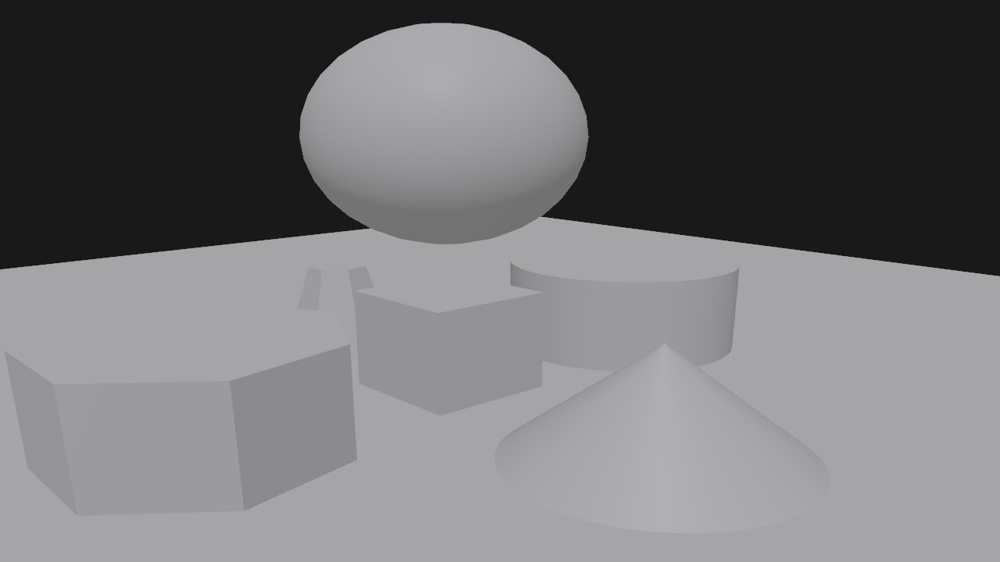
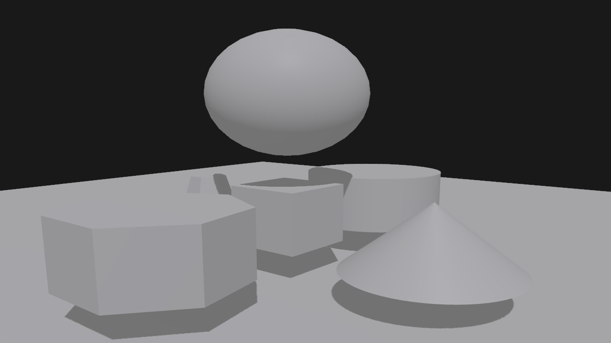
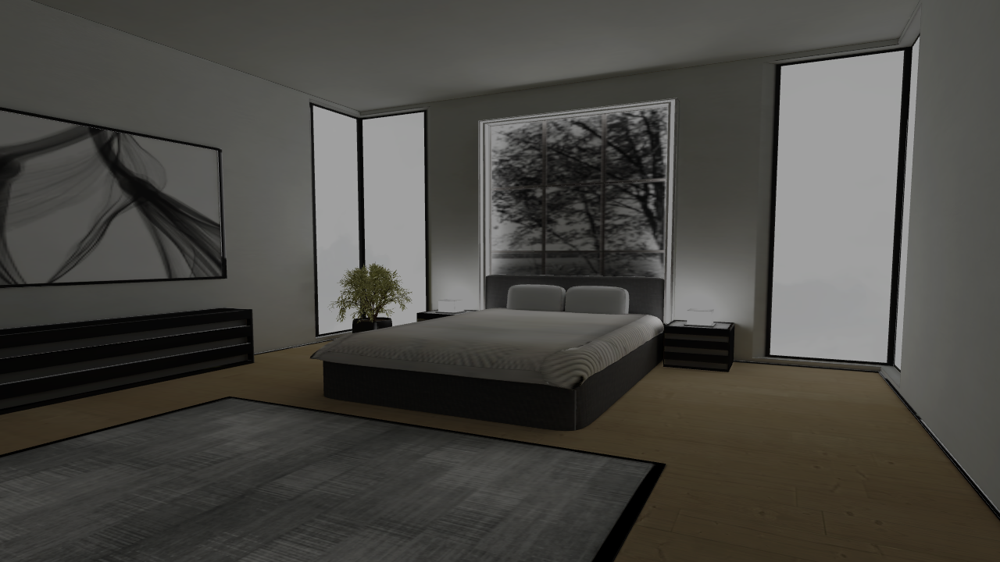
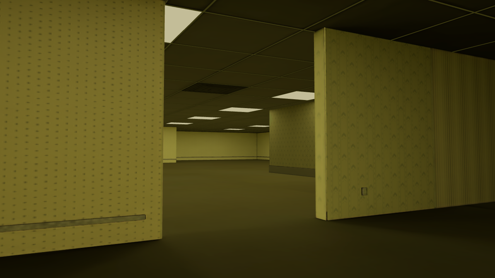

# 系统设计与实现说明

---

## 1. 总体设计目标与范围

Simple_3D_Modeling 的目标是构建一套轻量但可扩展的 3D 建模与浏览框架，涵盖以下主线能力：

1. **基础体素建模**：支持立方体、球、圆柱、圆锥、多面棱柱、多面棱台等常见原型的生成与组合。
2. **网格资源流转**：提供 OBJ/glTF 导入，以及 OBJ 导出。
3. **材质与纹理**：支持 PBR 参数与贴图，允许在 UI 层进行实时编辑与替换。
4. **几何变换**：实体具备平移、旋转、缩放等变换操作，形成场景层级与渲染矩阵。
5. **光照与光源编辑**：内置环境光、方向光与点光源，允许修改位置、方向、强度等参数。
6. **交互漫游与观察**：Orbit（环绕）、Pan、Zoom、Zoom To Fit、第一人称等观察模式。
7. **截图存档**：支持将当前帧缓冲保存到磁盘，便于留档或测试。
7. **实时碰撞检测**：支持简单的碰撞检测。
7. **实时阴影**：支持方向光的阴影绘制。

围绕以上目标，系统划分为 **Core/Interaction、Camera、Geometry & Assets、Graphics、Scene、Utils** 六大模块。它们以解耦的方式协作：输入与控制器驱动相机与交互；相机、场景与资源输入渲染器；渲染器完成 GPU 指令编排、光照与截图。后续章节将对每个模块展开描述。

---

## 2. 架构分层与模块职责

### 2.1 Core / Interaction
- **职责**：管理应用生命周期、窗口、输入事件，并把低层事件转化为上层可消费的 InputContext。
- **关键接口**：`include/interaction/inputSystem.h`、`include/interaction/inputContext.h`、`include/core/window.h` 等。
- **交互关系**：Orbit/FPS 等控制器通过 `InputContext` 读取鼠标/键盘状态，计算相机姿态；Window 负责截图请求的触发标记。

### 2.2 Camera
- **职责**：提供投影、视图矩阵与姿态计算；控制器将输入映射为相机参数变化。
- **关键类**：
    - `PerspectiveCamera`（定义于 `include/camera/perspectiveCamera.h`）：提供可配置的视锥参数与投影矩阵。
    - `OrbitCamera`（`include/camera/orbitCamera.h`）：以目标点、距离、Yaw/Pitch 表示姿态。
    - `OrbitCameraController`（`include/camera/orbitCameraController.h`）：结合输入进行 Orbit/Pan/Zoom。
    - `FPSCamera` 与控制器（类似模式）实现第一人称漫游。

### 2.3 Geometry & Assets
- **职责**：基础体素生成与外部网格/纹理/着色器的加载缓存。
- **关键类**：
    - `PrimitiveFactory`（`include/geometry/primitiveFactory.h` + `src/geometry/primitiveFactory.cpp`）：生成立方体、球、圆柱、圆锥、多面棱柱、多面棱台的 Mesh/Model。
    - `AssetManager`（`include/assets/assetManager.h` + `src/assets/assetManager.cpp`）：统一资源入口，包含纹理加载、OBJ/glTF 导入与着色器缓存。

### 2.4 Graphics
- **职责**：封装 GPU 资源（Mesh/Texture/Shader）、材质描述与渲染流程，处理光照、阴影、截图。
- **关键类**：
    - `Mesh`（`include/graphics/mesh.h`）：管理 VAO/VBO/EBO，提供绘制接口。
    - `Material`（`include/graphics/material.h`）：PBR 参数与纹理插槽，包含透明/双面渲染提示。
    - `Renderer`（`include/graphics/renderer.h` 及实现）：场景绘制、状态管理、阴影生成与截图输出。

### 2.5 Scene
- **职责**：组织渲染对象与光照。
- **关键类**：
    - `Transform`（`include/scene/transform.h`）：位移、旋转、缩放与模型矩阵缓存。
    - `Entity`（`include/scene/entity.h`）：组合 Transform、Material、Model，并包含可见性。
    - `Lighting` 与光源类型（`include/scene/lighting.h` 等）：环境光、方向光、点光源集合。
    - `Scene`（`include/scene/scene.h`）：实体容器与 Lighting 统一入口。

### 2.6 Utils
- **职责**：通用工具（配置、日志、OpenGL 基础模块），为其他模块提供支撑。

---

## 3. 核心数据结构与类说明

以下节选展示核心类的部分定义，帮助理解状态字段与接口约束。

### 3.1 PrimitiveFactory：体素生成器

路径：[include/geometry/primitiveFactory.h](include/geometry/primitiveFactory.h)

```cpp
enum class PrimitiveType
{
    Cube,       // 立方体
    Sphere,     // 球
    Cylinder,   // 圆柱
    Cone,       // 圆锥
    Prism,      // 多面棱柱
    Frustum     // 多面棱台
};

struct PrimitiveDesc
{
    PrimitiveType type = PrimitiveType::Cube;
    glm::vec3 size{1.0f, 1.0f, 1.0f};   // Cube
    float radius = 0.5f;                // Sphere, Cylinder
    int slices = 32;                    // 经线分段
    int stacks = 16;                    // 纬线分段
    float height = 1.0f;                // Cylinder / Cone / Prism / Frustum
    int sides = 16;                     // 圆周/多边形边数（>=3）
    bool caps = true;                   // 是否顶/底面
    float topRadius = 0.25f;            // Frustum / Cone
    float bottomRadius = 0.5f;          // Frustum
    bool smooth = true;                 // Prism/Frustum 建议 false（硬边）
};
```

在实现文件 `src/geometry/primitiveFactory.cpp` 中，针对每种原型使用参数化方式构建顶点与索引。以立方体和球体生成函数为例：

```cpp
// 立方体：6 个面 * 4 顶点 = 24 顶点，硬边法线与简单 UV
static void buildCube(const PrimitiveDesc& d,
                      std::vector<Mesh::Vertex>& outV,
                      std::vector<std::uint32_t>& outI)
{
    const glm::vec3 hs = d.size * 0.5f;
    struct Face { glm::vec3 n; glm::vec3 a,b,c,d; };
    // ... 构建 6 个面，填充 outV/outI ...
}

// UV 球体：经纬线参数化，支持 slices/stacks 精度控制
static void buildSphere(const PrimitiveDesc& d,
                        std::vector<Mesh::Vertex>& outV,
                        std::vector<std::uint32_t>& outI)
{
    const float r = std::max(0.0001f, d.radius);
    const int slices = clampMin(d.slices, 3);
    const int stacks = clampMin(d.stacks, 2);
    // ... 计算坐标/法线/UV，填充索引 ...
}
```

工厂最终提供 `CreateMesh` 和 `CreateModel` 两个静态接口，生成 Mesh 或 Model，便于直接放入 Entity。通过可调参数，满足需求 1 的体素建模能力。

### 3.2 Mesh：GPU 几何封装

路径：[include/graphics/mesh.h](include/graphics/mesh.h)

```cpp
class Mesh
{
public:
    struct Vertex
    {
        glm::vec3 position{0,0,0};
        glm::vec3 normal{0,1,0};
        glm::vec2 uv{0,0};
    };
    explicit Mesh(const std::vector<Vertex>& vertices,
                  const std::vector<std::uint32_t>& indices);
    void draw(GLenum primitive = GL_TRIANGLES) const;
    GLuint getVao() const { return vao; }
    // ...
private:
    void createOnGPU(const std::vector<Vertex>& vertices,
                     const std::vector<std::uint32_t>* indices);
    GLuint vao = 0, vbo = 0, ebo = 0;
    GLsizei vertexCount = 0, indexCount  = 0;
    
    std::vector<Vertex> cpuVertices;
    std::vector<std::uint32_t> cpuIndices;
};
```

Mesh 负责创建 VAO/VBO/EBO 并提供绘制方法。PrimitiveFactory 或 AssetManager 生成的几何数据在此处上传到 GPU。同时保留节点和索引便于模型的导出。

### 3.3 Model：多子网格与包围盒

路径：[include/assets/model.h](include/assets/model.h)

```cpp
struct Model
{
    struct Submesh
    {
        std::string name;
        std::shared_ptr<Mesh> mesh;
        glm::mat4 local{1.0f};
        std::shared_ptr<Material> material;
        AABB localBounds;
    };
    std::string sourcePath;
    std::vector<Submesh> submeshes;
    AABB bounds;
    bool hasMaterial() const;
};
```

每个 Submesh 可拥有独立材质与局部变换，并维护局部包围盒，模型整体包围盒在加载时累加。Renderer 在遍历 Entity 时直接使用 Model/Submesh 信息。

### 3.4 Material：PBR 材质参数

路径：[include/graphics/material.h](include/graphics/material.h)

```cpp
class Material
{
public:
    std::shared_ptr<Shader> shader;
    glm::vec4 baseColorFactor{1.0f};
    float metallicFactor  = 0.0f;
    float roughnessFactor = 0.5f;
    float normalScale = 1.0f;
    float occlusionStrength = 1.0f;
    glm::vec3 emissiveFactor{0.0f};
    float emissiveStrength = 1.0f;
    std::shared_ptr<Texture2D> baseColorMap;          // slot 0
    std::shared_ptr<Texture2D> normalMap;             // slot 1
    std::shared_ptr<Texture2D> metallicRoughnessMap;  // slot 2
    std::shared_ptr<Texture2D> occlusionMap;          // slot 3
    std::shared_ptr<Texture2D> emissiveMap;           // slot 4
    bool alphaBlend = false;
    bool doubleSided = false;
    bool isValid() const { return shader && (*shader); }
    GLuint program() const { return shader ? shader->id() : 0; }
    void clampParams();
};
```

材质支持 PBR 金属度/粗糙度工作流及多种贴图插槽，可通过 UI 实时调整。`clampParams` 对参数做范围限制以避免闪烁或越界。

### 3.5 AssetManager：资源加载与缓存

路径：[include/assets/assetManager.h](include/assets/assetManager.h) / [src/assets/assetManager.cpp](src/assets/assetManager.cpp)

核心职责：
- 纹理加载（支持色彩空间、翻转、mipmap、Wrap/Filter/各向异性等参数），并通过缓存键避免重复加载。
- OBJ 导入：借助 tinyobjloader 解析顶点/索引/法线/UV，按材质分 submesh（即便材质未使用也做分组）。
- glTF 2.0 导入：支持场景层级、节点变换、访问器读取（位置/法线/UV/索引等）。
- 着色器加载：以编译结果缓存，减少重复构建。

OBJ 加载的关键流程节选：

```cpp
std::shared_ptr<Model> AssetManager::loadModelOBJ(const std::string &relativePath, bool forceReload)
{
    const std::string abs = makeAbsPath(relativePath);
    // 1) 缓存查找
    // 2) 调 tinyobj::ObjReader 解析，triangulate=true
    // 3) 按 shape 遍历，按 material_id 分 builder（verts/indices/dedup）
    // 4) 缺失法线时以面法线填充
    // 5) 生成 Mesh 与 Submesh，计算局部/整体包围盒
    // 6) 写入缓存并返回
}
```

该实现满足需求 2 的导入部分；导出可在此模块新增 OBJ/GLTF 写出函数，复用 Model/Submesh 数据。

### 3.6 Transform 与 Entity

路径：[include/scene/transform.h](include/scene/transform.h) / [include/scene/entity.h](include/scene/entity.h)

`Transform` 支持位置、四元数旋转、欧拉角设置与缩放，内部缓存模型矩阵，只有脏标记时才更新。

```cpp
class Transform
{
public:
    void setPosition(const glm::vec3& p);
    void setRotation(const glm::quat& q);
    void setRotationEulerDeg(const glm::vec3& eulerDeg);
    void setScale(const glm::vec3& s);
    void translate(const glm::vec3& delta);
    void rotateEulerDeg(const glm::vec3& deltaEulerDeg);
    void rotateAxisDeg(const glm::vec3& axis, float angleDeg);
    const glm::mat4& modelMatrix() const;
private:
    glm::vec3 position{0.0f};
    glm::quat rotation{1.0f, 0.0f, 0.0f, 0.0f};
    glm::vec3 scale{1.0f, 1.0f, 1.0f};
    mutable glm::mat4 model{1.0f};
    mutable bool m_dirty{true};
};
```

Entity 将 Transform、Material、Model 聚合：

```cpp
class Entity
{
public:
    Transform& getTransform();
    Material& getMaterial();
    void setModel(std::shared_ptr<Model> model);
    bool isRenderable() const
    {
        return visible && model && !model->submeshes.empty()
               && (material.isValid() || model->hasMaterial());
    }
    // ...
private:
    bool visible = true;
    Transform transform;
    Material material;
    std::shared_ptr<Model> model;
};
```

### 3.7 Lighting 与 Scene

路径：[include/scene/lighting.h](include/scene/lighting.h) / [include/scene/scene.h](include/scene/scene.h)

Lighting 管理环境光、单个方向光与多个点光：

```cpp
class Lighting
{
public:
    glm::vec3 ambient{0.03f, 0.03f, 0.03f};
    void setDirectional(std::unique_ptr<DirectionalLight> light);
    PointLight& addPointLight();
    std::vector<std::unique_ptr<PointLight>>& pointLights();
private:
    std::unique_ptr<DirectionalLight> dir;
    std::vector<std::unique_ptr<PointLight>> points;
};
```

Scene 则持有实体数组与 Lighting，提供增删查接口：

```cpp
class Scene
{
public:
    Entity& createEntity(const std::string& name);
    Entity* at(size_t index);
    Lighting& getLighting();
private:
    std::vector<Entity::Ptr> entities;
    Lighting lighting;
};
```

### 3.8 Camera 和 CameraController

#### 3.8.1 Orbit 相机

路径：[include/camera/orbitCamera.h](include/camera/orbitCamera.h)

OrbitCamera 以目标点、距离、Yaw/Pitch 表征，支持 `orbit`、`pan`、`zoom` 操作：

```cpp
void OrbitCamera::orbit(float deltaYawDeg, float deltaPitchDeg);
void OrbitCamera::pan(float deltaX, float deltaY);
void OrbitCamera::zoom(float delta);
```

`getPosition` 根据 target + yaw/pitch + distance 计算世界坐标，`getViewMatrix` 返回缓存的视图矩阵。

#### 3.8.2 Orbit 控制器

路径：[include/camera/orbitCameraController.h](include/camera/orbitCameraController.h)

```cpp
class OrbitCameraController : public CameraController
{
public:
    explicit OrbitCameraController(OrbitCamera& cam) : m_cam(std::move(cam)) {}
    float rotateSensitivity = 0.15f;
    float panSensitivity    = 0.002f;
    float zoomSensitivity   = 0.5f;
    int orbitMouseButton = GLFW_MOUSE_BUTTON_RIGHT;
    int panMouseButton   = GLFW_MOUSE_BUTTON_MIDDLE;
    void update(const InputContext& input, float dt, void* ptr) override;
    Camera& getCamera() override { return m_cam;}
private:
    OrbitCamera m_cam;
};
```

控制器读取 InputContext（鼠标移动/滚轮/按键），映射为 Orbit/Pan/Zoom 操作，从而满足需求 6 的漫游交互。

#### 3.8.3 FPS 相机和控制器

虽然本文未展开 FPSCamera 的代码，但模式类似：以位置和前向向量表示姿态，控制器根据 WASD/鼠标实现自由移动与视角旋转。

### 3.9 Shader

路径：[include/graphics/shader.h](include/graphics/shader.h)

Shader 主要导入着色器并绑定句柄，同时支持传递 Uniform 参数。

```cpp
class Shader
{
public:
	...
    // 从文件
    bool loadFromFiles(const std::string& vertexPath, const std::string& fragmentPath);

    // 从源码
    bool loadFromSource(const std::string& vertexSrc, const std::string& fragmentSrc);

    void bind() const;
    static void unbind();

    GLuint id() const { return program; }
    explicit operator bool() const { return program != 0; }

    // uniform setters
    void setInt(const std::string& name, int v);
	...

private:
    GLuint program = 0;
    std::unordered_map<std::string, GLint> uniformCache;
};
```

### 3.9 Texture

路径：[include/graphics/texture.h](include/graphics/texture.h)

Texture 提供纹理的导入以及绑定。可以通过设置 TextureParams 来决定导入的形式。

```cpp
enum class ColorSpace
{
    Linear,
    SRGB
};

struct TextureParams
{
    ColorSpace colorSpace = ColorSpace::Linear;

    bool flipY = true;
    bool generateMipmaps = true;

    GLint wrapS = GL_REPEAT;
    GLint wrapT = GL_REPEAT;

    // 如果 generateMipmaps=true，建议 minFilter 用 *_MIPMAP_*
    GLint minFilter = GL_LINEAR_MIPMAP_LINEAR;
    GLint magFilter = GL_LINEAR;

    // 0 表示不设置；否则会 clamp 到硬件支持范围
    float anisotropy = 8.0f;

    // 有些贴图需要强制 4 通道
    // std::nullopt 表示保持原始通道数；可设为 3 或 4
    std::optional<int> forceChannels = std::nullopt;
};

class Texture2D
{
public:
	...
    bool loadFromFile(const std::string& path, const TextureParams& params = {});
    bool loadFromMemory(const unsigned char* data,
                        int width,
                        int height,
                        int channels,
                        const TextureParams& params = {});
    void destroy();

    void bind(GLuint unit = 0) const;

    GLuint id() const { return m_id; }
    int width() const { return m_width; }
    int height() const { return m_height; }
    int channels() const { return m_channels; }
    const std::string& path() const { return m_path; }

    explicit operator bool() const { return m_id != 0; }
    ...
};
```

### 3.10 Input 相关类

路径：[include/interaction/inputSystem.h](include/interaction/inputSystem.h) / [include/interaction/inputContext.h](include/interaction/inputContext.h)

InputSystem 负责设置输入回调函数，在函数中修改 InputContext。而 InputContext 记录一帧内的输入情况。

```cpp
class InputSystem
{
public:
    static void Attach(GLFWwindow* window, WindowContext* context);

private:
    static void KeyCallback(GLFWwindow* window, int key, int scancode, int action, int mods);
    static void MouseButtonCallback(GLFWwindow* window, int button, int action, int mods);
    static void CursorPosCallback(GLFWwindow* window, double xpos, double ypos);
    static void ScrollCallback(GLFWwindow* window, double xoffset, double yoffset);
    static void framebufferResizeCallback(GLFWwindow* window, int width, int height);
};

class InputContext
{
public:
	...
    // ===== GLFW 事件入口=====
    void OnKey(int key, int action);
    void OnMouseButton(int button, int action);
    void OnMouseMove(float x, float y);
    void OnScroll(float offset);

    // ===== 每帧更新 =====
    void Update();

    // ===== 查询接口 =====
    bool IsKeyDown(int key) const;
    bool IsKeyPressed(int key) const;
    bool IsKeyReleased(int key) const;

    bool IsMouseButtonDown(int button) const;

    glm::vec2 GetMousePosition() const;
    glm::vec2 GetMouseDelta() const;
    float GetScrollOffset() const;
	...
};
```


---

## 4. 运行时流程与数据流

### 4.1 启动与资源加载
1. Application 初始化窗口、OpenGL 上下文与日志系统（`src/core/application.cpp` 等）。
2. 创建 AssetManager，设置资源根目录（assets/）。
3. 通过 AssetManager 载入着色器、纹理与模型，或通过 PrimitiveFactory 生成基础体素。
4. 创建 Scene，向其中添加 Entity，并绑定 Model/Material/Transform。
5. 初始化 Camera 与控制器，订阅输入。

### 4.2 帧循环
每帧主要流程：
1. **输入处理**：InputSystem 收集事件，更新 InputContext。
2. **控制器更新**：Orbit/FPS 控制器读取 InputContext，更新相机参数（目标、距离、Yaw/Pitch 或位置/方向）。
3. **渲染前状态**：Renderer `beginFrame`，设置视口、清屏、深度/混合/多重采样等基础状态。
4. **场景绘制**：Renderer `renderScene` 遍历 Scene，上传光照、相机矩阵、材质参数并调用 Mesh 绘制；若启用阴影，会先生成 shadow map。
5. **截图请求**：若 Window 标记截图，则调用 `saveScreenshot` 将帧缓冲写入磁盘。
6. **交换缓冲**：Renderer `endFrame`，提交渲染结果。

### 4.3 资源生命周期
- AssetManager 使用弱引用缓存资源，当引用计数为 0 时可被清理。
- Mesh/Texture/Shader 在构造时创建 GPU 资源，在析构时释放。
- Scene/Entity 管理 CPU 侧对象，Renderer 仅临时读取。

---

## 5. 需求映射与完成度说明

### 基本要求
1. **基础体素建模**
    - 已实现：`PrimitiveFactory` 覆盖立方体、球、圆柱、圆锥、多面棱柱、多面棱台，支持尺寸、分段、是否封盖、硬/软法线等参数。
    
    - 典型调用：`auto model = PrimitiveFactory::CreateModel(desc); entity.setModel(model);`
    
      展示：
    
      
    
2. **网格导入/导出**
    - 导入：`AssetManager::loadModelOBJ`（OBJ），`loadModelGLTF2`（glTF 2.0）。
    - 导出：已实现 OBJ 文件的导出 `include/scene/sceneExporter.h`。 
    
3. **材质与纹理显示/编辑**
    - 已实现：`Material` 提供 PBR 参数与 5 路贴图；`AssetManager::loadTexture2D` 支持贴图加载；Entity 可替换材质或贴图。
    - 编辑入口：UI 层可直接通过 `Entity::getMaterial()` 得到材质并进行修改。
    
4. **几何变换（旋转、平移、缩放）**
    - 已实现：`Transform` 的 set/translate/rotate/scale 接口与模型矩阵缓存。
    
5. **光照与光源编辑**
    - 已实现：`Lighting` 包含环境光、方向光与点光集合；Renderer 上传到 Shader；光源参数可在 UI 编辑后同步到 `Lighting`。
    
6. **漫游/观察（Zoom In/Out、Pan、Orbit、Zoom To Fit 等）**
    - 已实现：`OrbitCamera` + `OrbitCameraController` 支持 Orbit/Pan/Zoom/距离限制；`FPSCamera` 控制器支持第一人称移动。
    - 输入映射：可在 InputSystem 中将鼠标/键盘事件写入 InputContext，控制器读取后更新相机参数。
    
7. **屏幕截取/保存**
    - 已实现：Renderer 的 `saveScreenshot` 使用 `stb_image_write` 将帧缓冲写盘；Window 层的 screenshotRequested 标记触发保存（参见 `src/core/window.cpp` 与 `src/graphics/renderer.cpp`）。

### 额外要求

1.  **漫游时可实时碰撞检测**

   - 已实现：较为简单的实现了实时碰撞，摄像机用球体包裹，物体基于顶点生成立方体包裹，实时计算球心到立方体的距离，判断是否发生碰撞。
   - 不足：导入的模型往往一个 mesh 顶点横跨距离较大，导致生成的立方体较大，在这种情况下，碰撞检测效果很差。
   
2.  **光照明模型细化，可任选实现实时阴影、caustic、全局光照明（光子跟踪）、辐射度等**
   - 已实现：实时阴影，Renderer 内部有 shadow map 支持（方向光），可基于 `shadowMapSize`、`shadowDistance` 等参数调节。
   
   - 不足：阴影较为粗糙，远离物体阴影消失较为突兀。
   
     展示：
   
     

### 总体实现效果





---

## 6. 资源与材质编辑工作流

1. **导入模型**：`auto model = assets.loadModelOBJ("models/xxx.obj");`

2. **创建或编辑材质**：

   
   
   ```cpp
   Material mat;
   mat.shader = assets.loadShader("pbr.vert", "pbr.frag");
   mat.baseColorFactor = {1,1,1,1};
   mat.metallicFactor = 0.2f;
   mat.roughnessFactor = 0.6f;
   mat.baseColorMap = assets.loadTexture2D("albedo.png", params);
   mat.normalMap = assets.loadTexture2D("normal.png", params);
   mat.clampParams();
   ```
   
3. **绑定到实体**：`entity.setModel(model); entity.setMaterial(mat);`

4. **实时编辑**：UI 层直接修改 `entity.getMaterial()` 的字段或替换纹理指针，Renderer 会在下一帧读取并上传。

---

## 7. 可靠性与校验

- **参数裁剪**：`PrimitiveFactory` 与 `Material::clampParams` 对关键参数做最小/范围限制，避免非法输入导致数值异常。
- **空指针检查**：Renderer 在绘制前检查 Entity 是否可渲染（模型/材质是否存在）。
- **日志**：资源加载失败会打印日志（使用 glog wrapper），便于追查问题。

---

## 8. 典型用例流程示例

### 8.1 创建一个体素并渲染
```cpp
PrimitiveDesc desc;
desc.type = PrimitiveType::Cylinder;
desc.radius = 0.5f;
desc.height = 2.0f;
desc.slices = 48;
auto model = PrimitiveFactory::CreateModel(desc);

Entity& e = scene.createEntity("pillar");
e.setModel(model);
e.getTransform().setPosition({0,1,0});
e.getMaterial().shader = assets.loadShader("pbr.vert", "pbr.frag");
```

### 8.2 载入 OBJ 并应用材质
```cpp
auto model = assets.loadModelOBJ("suzanne.obj");
TextureParams params{ /* sRGB, mipmap, wrap/filter 等 */ };
Material m;
m.shader = assets.loadShader("pbr.vert", "pbr.frag");
m.baseColorMap = assets.loadTexture2D("suzanne_albedo.png", params);
m.normalMap    = assets.loadTexture2D("suzanne_norm.png", params);
m.clampParams();

Entity& e = scene.createEntity("suzanne");
e.setModel(model);
e.setMaterial(m);
```

### 8.3 设置光源与截图
```cpp
Lighting& L = scene.getLighting();
auto dir = std::make_unique<DirectionalLight>();
dir->direction = glm::normalize(glm::vec3(-1, -1, -0.5f));
dir->color = glm::vec3(1.0f);
L.setDirectional(std::move(dir));

PointLight& p = L.addPointLight();
p.position = {2, 2, 2};
p.color = {1, 0.8f, 0.6f};
p.intensity = 5.0f;

// 在 UI/输入中触发 screenshotRequested = true
renderer.saveScreenshot("screenshots/frame.png");
```

---

## 11. 结论

本项目已经为 3D 建模与实时浏览奠定了坚实的基础：具备体素生成、资源导入、PBR 材质、光照、相机漫游与截图等核心能力；架构层次清晰，模块接口简洁，便于在 UI、后处理、导出、阴影优化等方向继续演进。

---

## 附录：

### 关键文件速查索引

- 体素生成：[include/geometry/primitiveFactory.h](include/geometry/primitiveFactory.h) / [src/geometry/primitiveFactory.cpp](src/geometry/primitiveFactory.cpp)
- 模型/纹理/着色器加载：[include/assets/assetManager.h](include/assets/assetManager.h) / [src/assets/assetManager.cpp](src/assets/assetManager.cpp)
- Mesh 封装：[include/graphics/mesh.h](include/graphics/mesh.h)
- 材质与纹理：[include/graphics/material.h](include/graphics/material.h) / [include/graphics/texture.h](include/graphics/texture.h)
- 渲染器与截图：[include/graphics/renderer.h](include/graphics/renderer.h) / [src/graphics/renderer.cpp](src/graphics/renderer.cpp)
- 变换与实体：[include/scene/transform.h](include/scene/transform.h) / [include/scene/entity.h](include/scene/entity.h)
- 光照：[include/scene/lighting.h](include/scene/lighting.h) / [include/scene/directionalLight.h](include/scene/directionalLight.h) / [include/scene/pointLight.h](include/scene/pointLight.h)
- 场景：[include/scene/scene.h](include/scene/scene.h)
- 相机与控制器：[include/camera/orbitCamera.h](include/camera/orbitCamera.h) / [include/camera/orbitCameraController.h](include/camera/orbitCameraController.h) / [include/camera/fpsCamera.h](include/camera/fpsCamera.h) / [include/camera/fpsCameraController.h](include/camera/fpsCameraController.h)
- 输入：[include/interaction/inputSystem.h](include/interaction/inputSystem.h) / [include/interaction/inputContext.h](include/interaction/inputContext.h)
- 截图相关：[src/graphics/renderer.cpp](src/graphics/renderer.cpp) / [src/core/window.cpp](src/core/window.cpp) / [include/core/application.h](include/core/application.h)
- 复制资源到执行目录：[copy_resources.py](copy_resources.py)

### 环境

包管理器：`vcpkg`

开发环境：`CLion`

构建工具：`ninja`

编译器：`MSVC`

Opengl 及其他库：请查看 [vcpkg.json](vcpkg.json) ，里面有详细版本。
